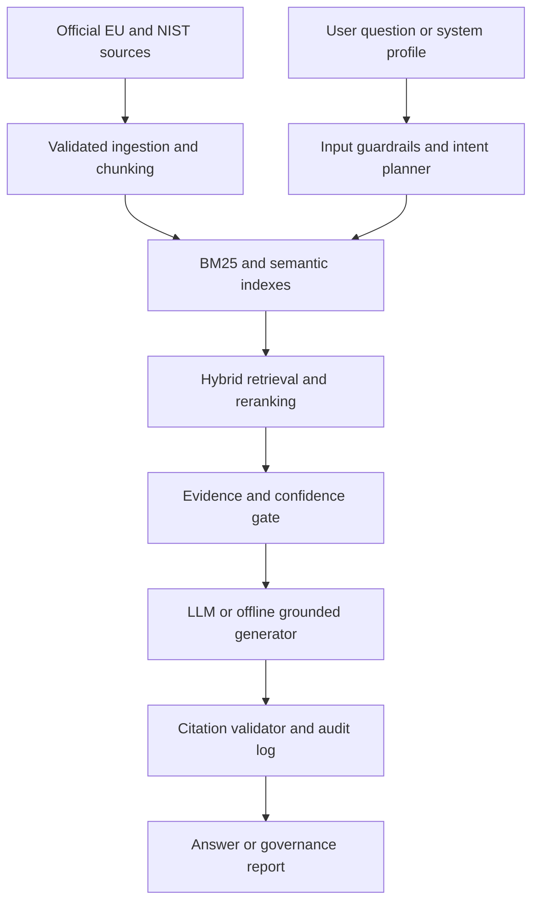
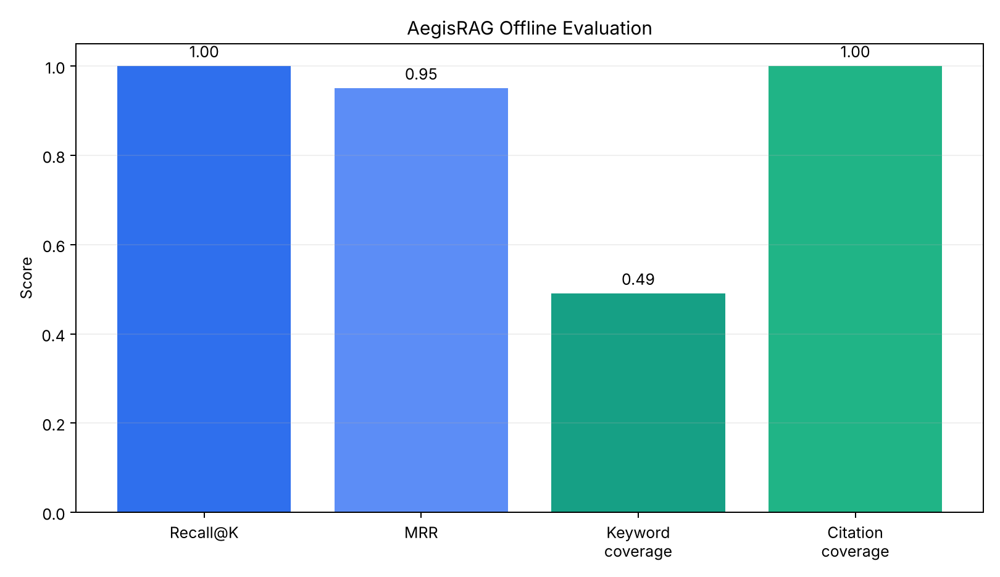

# AegisRAG: Evidence-Grounded AI Governance Copilot

[](https://www.python.org/)
[](https://fastapi.tiangolo.com/)
[](https://streamlit.io/)
[](#testing)
[](LICENSE)

AegisRAG is a production-style Generative AI project that helps teams perform preliminary AI-governance analysis using evidence from the **EU AI Act** and the **NIST AI Risk Management Framework**.

It combines hybrid retrieval, LLM-based grounded generation, inline source citations, AI-system risk screening, prompt-injection defence, PII redaction, evaluation, audit logging, a REST API, and an interactive web application.

> AegisRAG provides decision support, not legal advice or a conformity assessment.

## Why this project matters

Organisations adopting AI must connect product decisions to legal requirements, risk controls, technical evidence, and accountable human review. Ordinary chatbots may answer confidently without reliable evidence. AegisRAG is designed to retrieve authoritative material, abstain when evidence is weak, and leave an auditable trace of each result.

## Demonstrated capabilities

- Agentic flow: guardrail → intent planner → query expansion → hybrid retrieval → reranking → evidence check → generation → citation validation
- Custom BM25 lexical retrieval combined with latent semantic analysis
- Optional dense embeddings through Sentence Transformers
- OpenAI-compatible, Ollama, and IBM watsonx.ai generation adapters
- Deterministic offline evidence generator for reproducible demonstrations
- EU AI Act risk screening for prohibited, high-risk, transparency, and minimal-risk signals
- Control-gap analysis and audit-ready Markdown reports
- Prompt-injection detection and PII redaction before retrieval
- Confidence-based abstention when the knowledge base is insufficient
- FastAPI endpoints, Streamlit UI, Docker Compose, automated tests, and CI

## System architecture



Detailed design: [Architecture documentation](docs/architecture.md)

## Real data sources

The included knowledge base contains paraphrased, traceable reference notes linked to official sources:

- [Regulation (EU) 2024/1689 — EUR-Lex](https://eur-lex.europa.eu/eli/reg/2024/1689/oj/eng)
- [European Commission AI Act policy portal](https://digital-strategy.ec.europa.eu/en/policies/regulatory-framework-ai)
- [NIST AI Risk Management Framework](https://www.nist.gov/itl/ai-risk-management-framework)
- [NIST Generative AI Profile](https://www.nist.gov/publications/artificial-intelligence-risk-management-framework-generative-artificial-intelligence)

Every knowledge document stores its source URL, framework, legal or framework reference, topics, and verification date.

## Verified offline evaluation

The repository contains a reproducible ten-question evaluation set. The committed outputs were generated from the included corpus without an external API key.

| Metric | Result |
|---|---:|
| Retrieval Recall@5 | **100%** |
| Mean Reciprocal Rank | **0.95** |
| Citation coverage | **100%** |
| Answer keyword coverage | **49.0%** |
| Average retrieval confidence | **78.1%** |
| Automated tests | **16/16 passed** |

The offline generator prioritises deterministic evidence extraction over fluent wording. An external or local LLM can improve answer synthesis while the same retrieval and citation controls remain active.



Evaluation outputs:

- [Summary metrics](artifacts/evaluation_summary.json)
- [Question-level results](artifacts/evaluation_details.csv)
- [Sample AI-system assessment](artifacts/sample_audit_report.md)
- [Grounded demo transcript](artifacts/demo_transcript.json)

## Project structure

```text
aegisrag-ai-governance-copilot/
├── aegisrag/                  # Core RAG, agents, risk engine, API and evaluation
├── data/
│   ├── knowledge_base/       # Traceable EU AI Act and NIST reference notes
│   ├── evaluation/           # Ground-truth retrieval questions
│   └── sample_systems/       # Realistic AI-system profiles
├── artifacts/                # Generated metrics, chart, report and transcript
├── notebooks/                # Executed end-to-end demonstration
├── scripts/                  # Evaluation and report generation
├── tests/                    # Retrieval, risk, guardrail and orchestration tests
├── docs/                     # Architecture, data, model and threat documentation
├── app.py                    # Streamlit application
├── run_demo.py               # One-command offline demonstration
├── Dockerfile
├── docker-compose.yml
└── requirements.txt
```

## Quick start on Windows

```powershell
git clone https://github.com/rushipatil1318-boop/aegisrag-ai-governance-copilot.git
cd aegisrag-ai-governance-copilot
python -m venv .venv
.venv\Scripts\activate
python -m pip install --upgrade pip
pip install -r requirements.txt
```

Run the offline demonstration:

```powershell
python run_demo.py
```

Generate the evaluation and audit artifacts:

```powershell
python scripts/evaluate.py
python scripts/generate_demo.py
```

Launch the web application:

```powershell
streamlit run app.py
```

Launch the API:

```powershell
python -m uvicorn aegisrag.api:app --reload
```

Open `http://127.0.0.1:8000/docs` for interactive API documentation.

## API examples

Ask an evidence-grounded question:

```bash
curl -X POST http://127.0.0.1:8000/v1/ask \
  -H "Content-Type: application/json" \
  -d '{"question":"What controls are expected for a high-risk AI system?","top_k":5}'
```

Assess an AI system:

```bash
curl -X POST http://127.0.0.1:8000/v1/assess \
  -H "Content-Type: application/json" \
  -d '{"system_name":"Hiring Ranker","purpose":"Rank job applicants","employment":true,"impacts_individuals":true}'
```

## LLM provider configuration

The default `offline` mode needs no API key. Copy `.env.example` to `.env` and select another provider when needed.

### OpenAI-compatible endpoint

```env
LLM_PROVIDER=openai
LLM_MODEL=gpt-4.1-mini
LLM_API_KEY=your_key
LLM_BASE_URL=https://api.openai.com/v1
```

### IBM watsonx.ai

```env
LLM_PROVIDER=watsonx
WATSONX_API_KEY=your_key
WATSONX_PROJECT_ID=your_project_id
WATSONX_URL=https://eu-de.ml.cloud.ibm.com
WATSONX_MODEL_ID=ibm/granite-3-8b-instruct
```

### Local Ollama

```env
LLM_PROVIDER=ollama
LLM_MODEL=granite3.1-dense:8b
OLLAMA_BASE_URL=http://localhost:11434
```

Secrets are read only from environment variables and are excluded by `.gitignore`.

## Docker

```bash
cp .env.example .env
docker compose up --build
```

- API: `http://localhost:8000/docs`
- Streamlit: `http://localhost:8501`

## Testing

```bash
pip install -r requirements-dev.txt
python -m pytest
```

The CI workflow runs linting, tests, coverage, and the offline evaluation on every push and pull request.

## Responsible-AI design

- Official-source allowlist and source metadata
- Explicit distinction between legal requirements and voluntary guidance
- Prompt-injection detection before retrieval
- Redaction of common email, phone, and IBAN patterns
- Evidence-confidence threshold with abstention
- Citation allowlist to remove unsupported citation identifiers
- Trace IDs and append-only audit events
- Clear limitation and legal-review notices

See the [Threat model](docs/threat_model.md), [Data card](docs/data_card.md), and [System card](docs/system_card.md).

## Limitations

- Automated screening cannot determine legal status on its own.
- The included reference notes are not a replacement for the complete official texts.
- Legal guidance and implementation timelines can change; source verification must be repeated.
- Offline LSA retrieval is intentionally lightweight. Dense embeddings can improve paraphrase retrieval.
- External LLM quality, cost, privacy, and availability depend on the selected provider.

## Author

**Rushikesh Patil**  
M.Sc. Business Intelligence and Data Science  
Machine Learning · Generative AI · Responsible AI · AI Engineering

## License

Released under the [MIT License](LICENSE).

